<a href="https://b3rt0.tech">
<picture>
  <source media="(prefers-color-scheme: dark)" srcset="./assets/hero-dark.svg">
  
</picture>
</a>

Profissional de TI com cerca de 3 anos de trajetória em suporte, infraestrutura e sustentação cloud e de aplicações. Experiência prática na criação e operação de VPS Linux (DigitalOcean e OCI), Docker, Docker Compose, Nginx como proxy reverso, automação de backups com Python e Bash, e operação de Zabbix e Grafana com modelos prontos. Atuação no backend do marcae.online (em produção) com Node.js, Express, PostgreSQL, API REST, migrations e homologação controlada.

## Projetos em destaque

<a href="https://github.com/b3rt0-tech/hawkdot"><picture>
  <source media="(prefers-color-scheme: dark)" srcset="./assets/projeto-hawkdot-dark.svg">
  
</picture></a>
<a href="https://github.com/b3rt0-tech/base-scraping"><picture>
  <source media="(prefers-color-scheme: dark)" srcset="./assets/projeto-base-scraping-dark.svg">
  
</picture></a>

<a href="https://b3rt0.tech"><picture>
  <source media="(prefers-color-scheme: dark)" srcset="./assets/btn-site-dark.svg">
  
</picture></a>
<a href="https://www.linkedin.com/in/felipefranceschini"><picture>
  <source media="(prefers-color-scheme: dark)" srcset="./assets/btn-linkedin-dark.svg">
  
</picture></a>

- Site: [b3rt0.tech](https://b3rt0.tech)
- LinkedIn: [linkedin.com/in/felipefranceschini](https://www.linkedin.com/in/felipefranceschini)
